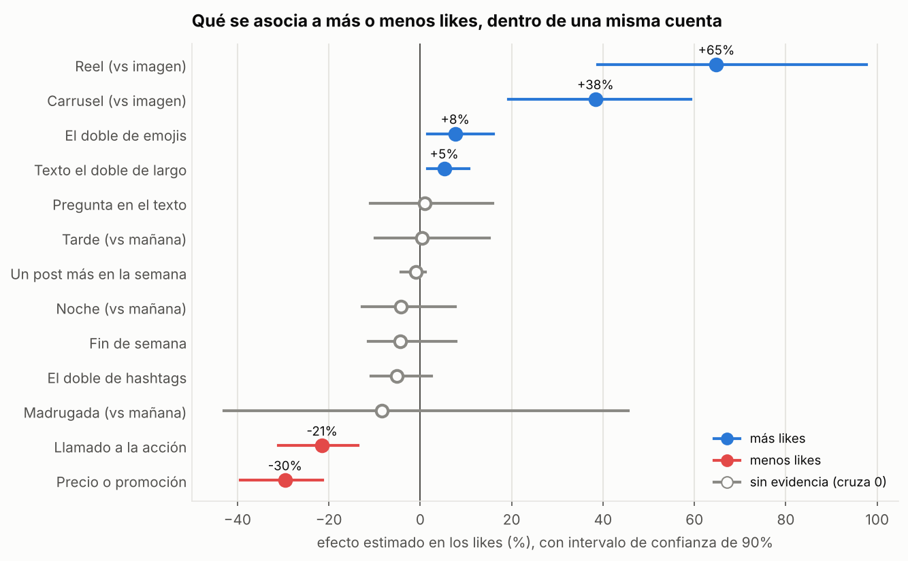
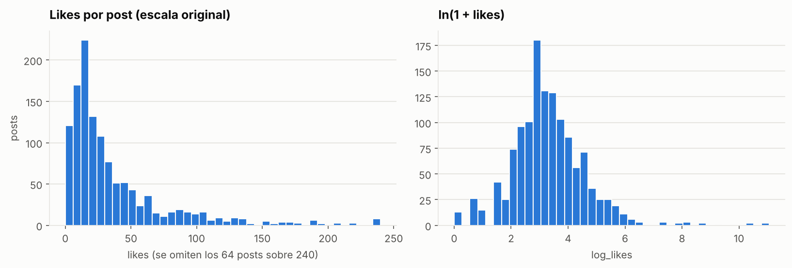
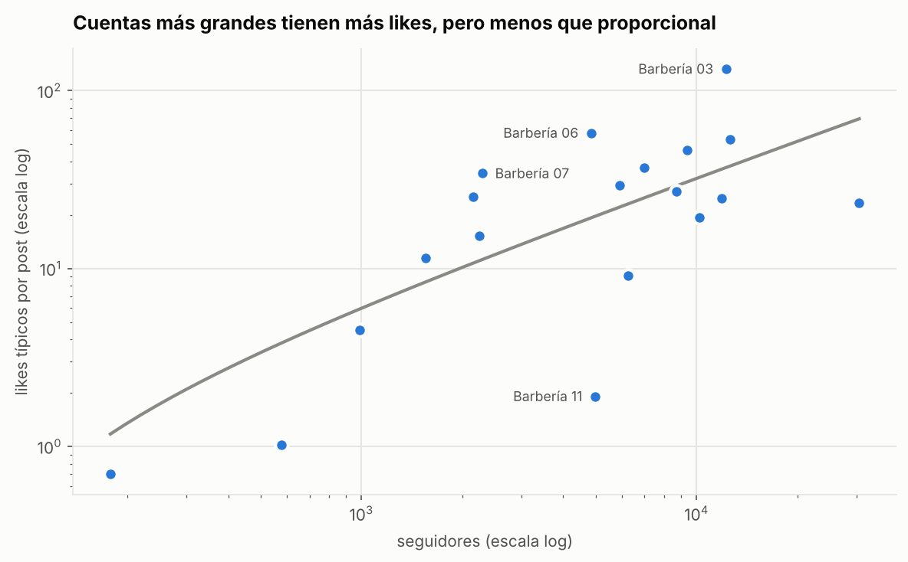
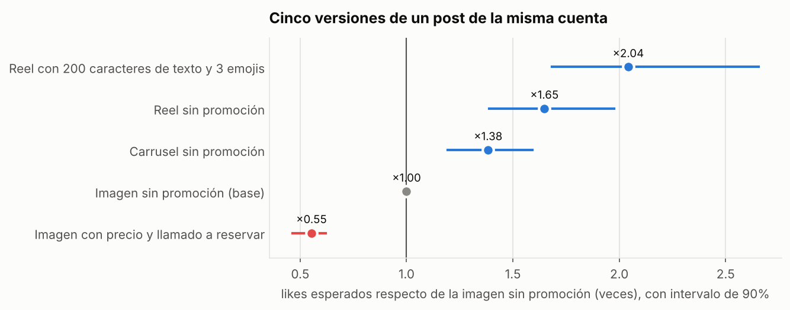
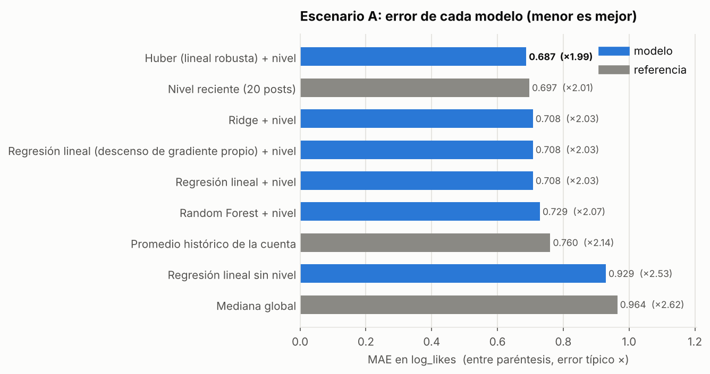

# ¿Qué hace que un post de barbería rinda en Instagram?

[](https://github.com/newbothi/analisis-barberias-peluquerias/actions/workflows/pruebas.yml)

**analisis-barberias-peluquerias** · machine learning con datos públicos de Instagram de 19 barberías de Santiago

Un proyecto de punta a punta: extracción con la API de Instagram, base de datos en SQL Server, limpieza y
features en Python, exploración, modelos predictivos validados en el tiempo, interpretación con intervalos de confianza,
un dashboard en Power BI y controles de calidad automáticos sobre los datos, el modelo y lo que se publica.

**Preguntas:**

1. ¿Qué decisiones al publicar (formato, texto, promociones, horario) se asocian a más likes?
2. ¿Qué tan predecibles son los likes de un post?

## Resultados en 30 segundos



- **El formato es lo que más importa.** Dentro de una misma cuenta, un **reel** rinde cerca de **+65%** más likes que una
  imagen sola, y un **carrusel**, cerca de **+38%**. Entre reel y carrusel no hay un ganador claro.
- **Los avisos reciben menos likes.** Los posts con **llamado a la acción** (agenda, reserva, WhatsApp) rinden **−21%**, y los
  que mencionan **precios o promociones**, **−30%**. Su objetivo es vender: hay que medirlos por reservas, no por likes.
- **El texto suma poco** (más largo, +5%; con emojis, +8%), y **la hora, el día, los hashtags, las preguntas y la frecuencia no
  muestran efecto**. Los consejos genéricos de "publica a las 19:00" no se sostienen con estos datos.
- **Lo que más predice un post es la propia cuenta.** El rendimiento de sus últimos 20 posts ya deja el error típico en
  ×2 (la predicción queda, en promedio, entre la mitad y el doble de los likes reales). El mejor modelo mejora eso solo un
  poco. Y para una barbería **sin historial**, ningún modelo le gana a la mediana.
- **Los likes están extremadamente concentrados:** el 1% de los posts se lleva el 80% de todos los likes, y esos virales
  (humor, contingencia) no son predecibles con datos públicos.

## Datos

La fuente es **Business Discovery** de la API de Instagram (Graph API v26.0), que entrega los datos públicos de cuentas
profesionales: seguidores y, por post, fecha, formato, caption, likes y comentarios. No entrega alcance, guardados,
compartidos ni reservas.

| Paso | Cuentas | Posts |
|---|---|---|
| Barberías de Santiago en la lista (armada a mano desde Google Maps y sitios de reserva) | 42 | |
| Con Instagram identificado / extraídas por la API | 39 / 37 | 2.642 |
| Con posts en los últimos 12 meses | 32 | 1.486 |
| Posts válidos: sin sorteos, con likes visibles y al menos 7 días de antigüedad | | 1.372 |
| **Cuentas con al menos 10 posts válidos: dataset final** | **19** | **1.292** |

Período: octubre de 2025 a octubre de 2026. Los datos fila a fila **no están en este repositorio** (ver
[Privacidad](#privacidad-y-datos)).

## Método

| Fase | Qué se hizo | Código |
|---|---|---|
| 1. Extracción | Cliente de la API con paginación, control de límites de uso, reintentos y token oculto en los logs. Guarda en SQL Server, cuenta por cuenta en transacciones | [`extraer_instagram.py`](extraer_instagram.py), [`sql/`](sql) |
| 2. Limpieza y features | Hora de Chile, embudo de limpieza, **detección de la plantilla** que cada cuenta repite en sus captions (para medir el texto propio del post), features de formato, texto, horario y ritmo | [`preparar_features.py`](preparar_features.py) |
| 3. Exploración | Efectos medidos **dentro de cada cuenta**, con intervalos por bootstrap de cuentas | [`03_exploracion.ipynb`](notebooks/03_exploracion.ipynb) |
| 4. Modelo | Target `ln(1 + likes)`. Validación **temporal** (se entrena con el pasado y se evalúa el futuro) y **por cuenta**. Referencias simples, regresión lineal, Ridge, Huber, Random Forest y una **regresión con descenso de gradiente implementada desde cero** | [`entrenar_modelo.py`](entrenar_modelo.py), [`regresion_gd.py`](regresion_gd.py), [`04_modelo.ipynb`](notebooks/04_modelo.ipynb) |
| 5. Interpretación | Efectos en % con IC 90% por **bootstrap de cuentas** (500 reentrenamientos), contraste con la Fase 3, sensibilidad sacando una cuenta a la vez, recomendaciones | [`interpretar_modelo.py`](interpretar_modelo.py), [`05_interpretacion.ipynb`](notebooks/05_interpretacion.ipynb) |
| 5. Presentación | Tablas anonimizadas y guía para el dashboard de Power BI | [`preparar_dashboard.py`](preparar_dashboard.py), [`powerbi/`](powerbi) |

El detalle de cada script (opciones, tablas, decisiones) está en [`docs/DETALLE_FASES.md`](docs/DETALLE_FASES.md).

**Tres decisiones que importan:**

- **Comparar dentro de cada cuenta.** Si las cuentas grandes publican más reels, comparar todos los reels contra todas las
  imágenes mezclaría el formato con el tamaño de la cuenta. Todos los efectos se miden a igual cuenta.
- **Remuestrear cuentas, no posts.** Los posts de una misma cuenta se parecen entre sí. Un bootstrap de posts daría
  intervalos falsamente angostos; uno de cuentas refleja que en realidad hay 19 unidades independientes.
- **No mirar el futuro.** El nivel reciente de la cuenta usa solo los posts anteriores a cada post, y la validación
  temporal entrena siempre con el pasado. Una prueba automática verifica que cambiar los likes futuros no cambia
  ninguna predicción anterior.

## Resultados

### Los likes están muy concentrados



La mediana es de 23 likes por post, pero hay posts con decenas de miles. Por eso el modelo predice `ln(1 + likes)` y el
error se mide en esa escala.

### La cuenta pesa más que el post



La cuenta explica cerca del **41%** de la variación de los likes. Las cuentas más grandes tienen más likes, pero menos que
proporcionalmente (el doble de seguidores se asocia a ~60% más likes), y cuentas de tamaño parecido rinden muy distinto.

### Qué decisiones importan



Para hacerlo concreto: si una imagen sin promoción de una cuenta suele sacar 30 likes, el modelo espera ~17 para una
imagen con precio y llamado a reservar, ~42 para un carrusel, ~49 para un reel y ~61 para un reel con un texto más
desarrollado y emojis. Son promedios de muchos posts; cada post individual varía mucho.

| Variable | Efecto en likes | IC 90% | Conclusión |
|---|---|---|---|
| Reel (vs imagen) | +65% | +39% a +98% | más likes |
| Carrusel (vs imagen) | +38% | +19% a +59% | más likes |
| Emojis (el doble) | +8% | +2% a +16% | más likes (débil) |
| Texto propio (el doble de largo) | +5% | +2% a +11% | más likes (débil) |
| Llamado a la acción | −21% | −31% a −14% | menos likes |
| Precio o promoción | −30% | −39% a −21% | menos likes (31 posts) |
| Hora, día, hashtags, preguntas, frecuencia | entre −8% y +1% | todos cruzan el 0 | sin evidencia |

Las conclusiones se mantienen al sacar cualquiera de las 19 cuentas y coinciden con las comparaciones simples de la
exploración.

### Qué tan predecible es



| Escenario | Mejor opción | Error típico | R² |
|---|---|---|---|
| **A. Barbería conocida** (próximos posts de una cuenta con historial) | Huber (regresión robusta) + nivel reciente | **×1,99** | 0,44 |
| A, referencia | Promedio de los últimos 20 posts de la cuenta | ×2,01 | 0,43 |
| **B. Barbería nueva** (cuenta nunca vista) | Ninguno le gana a la mediana global | ×2,67 | ≈ 0 |

La regresión robusta (Huber) le gana a la lineal clásica porque los virales distorsionan el error cuadrático, y Random
Forest no ayuda con 19 cuentas y relaciones casi lineales. La regresión con descenso de gradiente propio llega a los
mismos coeficientes que scikit-learn.

## Dashboard

El dashboard de Power BI tiene 4 páginas: resumen del nicho, qué funciona, modelo y detalle por barbería.
`python preparar_dashboard.py` genera sus datos anonimizados y [`powerbi/GUIA_DASHBOARD.md`](powerbi/GUIA_DASHBOARD.md)
explica cómo armarlo (relaciones, medidas DAX y visuales), con la paleta en [`powerbi/tema.json`](powerbi/tema.json).

<!-- Capturas del dashboard: agrégalas en docs/img/ y descomenta estas líneas


-->

## Calidad (QA y QC)

| Tipo | Control | Qué hace |
|---|---|---|
| QA | [Integración continua](.github/workflows/pruebas.yml) | GitHub corre las 115 pruebas en una máquina limpia en cada push (badge de arriba) |
| QA | [Escaneo de privacidad](tests/test_privacidad.py) | Falla si algo publicable contiene un token, tus credenciales, usernames o nombres reales, o un notebook sin anonimizar |
| QC | [Validación de datos](calidad/validar_datos.py) | 24 reglas sobre la tabla de posts (ids únicos, rangos, coherencia entre columnas, ventana de fechas). Si falla, no se guarda ni se entrena nada |
| QC | [Control del modelo](calidad/controlar_modelo.py) | El modelo nuevo solo reemplaza al guardado si le gana a la referencia simple, tiene R² > 0, no empeora más de un 5% y sus predicciones son válidas |

El detalle de cada control, los reportes y qué hacer si algo falla están en [`docs/CALIDAD.md`](docs/CALIDAD.md).

## Limitaciones

- **Asociaciones, no causas.** Si los reels rinden más, puede ser por el formato o porque se usan para el mejor contenido.
  Solo un experimento separaría ambas cosas. Tampoco se ve si un post tuvo publicidad pagada.
- **Likes, no negocio.** Los datos públicos no muestran alcance, guardados ni reservas, que es lo que buscan los avisos.
- **Muestra chica y de un nicho.** 19 barberías de una ciudad en 12 meses; algunos grupos son pequeños (31 posts con
  precio o promoción, 159 imágenes).
- **Seguidores actuales.** La API da los seguidores de hoy, no los que tenía la cuenta al publicar cada post.
- **Texto por reglas.** El llamado a la acción, las preguntas y las promociones se detectan con expresiones regulares.

## Cómo reproducirlo

**Requisitos:** Windows con Python 3.10+, SQL Server con *ODBC Driver 18* y una app de Meta for Developers con una cuenta
profesional de Instagram vinculada a una página de Facebook. El token necesita los permisos `pages_show_list`,
`pages_read_engagement`, `instagram_basic`, `instagram_manage_insights`, `business_management` y `ads_read`.

```powershell
git clone https://github.com/newbothi/analisis-barberias-peluquerias.git
cd analisis-barberias-peluquerias
python -m venv .venv
.venv\Scripts\Activate.ps1
pip install -r requirements.txt

copy .env.example .env                                      # completa IG_USER_ID, ACCESS_TOKEN y SQL_CONEXION
copy data\barberias_ejemplo.csv data\barberias_santiago.csv # reemplaza por tu propia lista de cuentas
```

Ejecuta `sql/01_esquema.sql` y `sql/03_features.sql` en SSMS, y luego:

```powershell
python extraer_instagram.py --probar --usuarios nombre.de.una.cuenta   # prueba sin tocar SQL Server
python extraer_instagram.py                                            # Fase 1: extracción
python preparar_features.py --min-posts 10                             # Fase 2: limpieza y features
python entrenar_modelo.py                                              # Fase 4: modelos
python interpretar_modelo.py                                           # Fase 5: efectos con IC
python preparar_dashboard.py                                           # Fase 5: datos del dashboard
python -m pytest -q                                                    # 115 pruebas, sin API ni SQL Server
```

Los notebooks se pueden ver directamente en GitHub. Para ejecutarlos, ábrelos en VS Code con la extensión *Jupyter* y el
`.venv` del proyecto como kernel.

## Estructura del proyecto

```
├── extraer_instagram.py        Fase 1: API de Instagram → SQL Server
├── preparar_features.py        Fase 2: limpieza, plantilla de captions y features
├── entrenar_modelo.py          Fase 4: validación y modelo final
├── regresion_gd.py             Fase 4: regresión lineal con descenso de gradiente propio
├── interpretar_modelo.py       Fase 5: efectos con bootstrap de cuentas y recomendaciones
├── preparar_dashboard.py       Fase 5: tablas para Power BI
├── anonimizar.py               códigos "Barbería 01..N" para notebooks y dashboard
├── calidad/                    QC: validación de datos y control del modelo
├── sql/                        esquema, consultas de revisión y tablas de features
├── notebooks/                  03 exploración · 04 modelo · 05 interpretación (ejecutados y anonimizados)
├── data/
│   ├── barberias_ejemplo.csv   formato de la lista de cuentas (ficticia)
│   ├── resultados_modelos.csv  métricas de cada modelo
│   ├── coeficientes_modelo.csv coeficientes del modelo final
│   ├── interpretacion_coeficientes.csv   efectos con IC y recomendaciones
│   └── efectos_dentro_de_cuentas.csv     comparaciones de la Fase 3 con IC
├── modelos/                    modelo final (.joblib) y su ficha (.json)
├── powerbi/                    guía del dashboard y tema de colores
├── docs/                       detalle técnico por fase, plan de calidad e imágenes del README
├── tests/                      pruebas con datos sintéticos y escaneo de privacidad (pytest)
└── .github/workflows/          integración continua (GitHub Actions)
```

## Privacidad y datos

- **No se publican datos fila a fila** (posts, captions, likes por post) ni la lista de cuentas con sus direcciones. Los
  términos de la plataforma de Meta no permiten redistribuirlos, y los captions mencionan a barberos y clientes con su
  usuario personal. Esos archivos están en `.gitignore`; quien quiera reproducir el análisis los genera con su propio token.
- **Las cuentas aparecen anonimizadas** como "Barbería 01" a "Barbería 19" (01 = la que tiene más posts) en notebooks,
  dashboard e imágenes, y no se muestra el texto de ningún post. Lo publicado son resultados agregados.
- **Credenciales:** el token y los IDs viven solo en `.env`, que nunca se sube. `.env.example` muestra el formato.

## Próximos pasos

- **Predicción temprana:** capturar los likes de cada post varias veces en sus primeras horas y predecir su rendimiento
  final a partir de cómo arranca.
- **Estrategias de contenido:** agrupar a las barberías según cómo publican (formato, ritmo, tipo de texto) y comparar
  cómo le va a cada grupo.
